# Origin to Selected

**Origin to Selected** lets you set a mesh object’s origin position and local axis orientation using a geometry selection in **Edit Mode**.

The extension provides two functions: **move the origin and align an axis**, or **align an axis without moving the origin**.

## Choosing an Axis

For either function, the **X, Y and Z** buttons select the local axis to align. The **−X, −Y and −Z** buttons align it in the opposite direction.

## Move the Origin and Align an Axis

This function is available in the **Align Origin Axis to Selected** section of the panel.

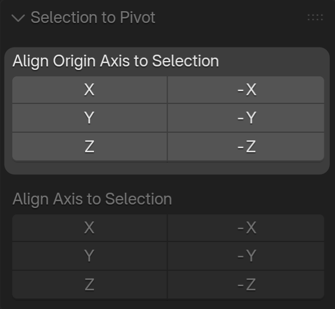

This function moves the origin to the center of the selection and aligns the chosen local axis with the direction determined from the selected geometry.

The selection center is the average position of the selected vertices.

### Example

**Before the operation:** the geometry is selected, and the origin is offset from the selection.

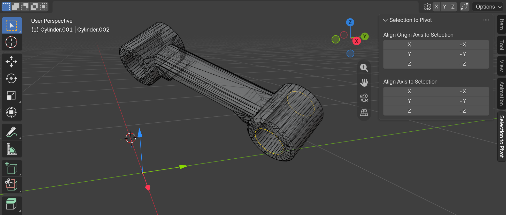

**After clicking Z:** the origin moves to the selection center, and the local Z axis aligns with the detected direction.

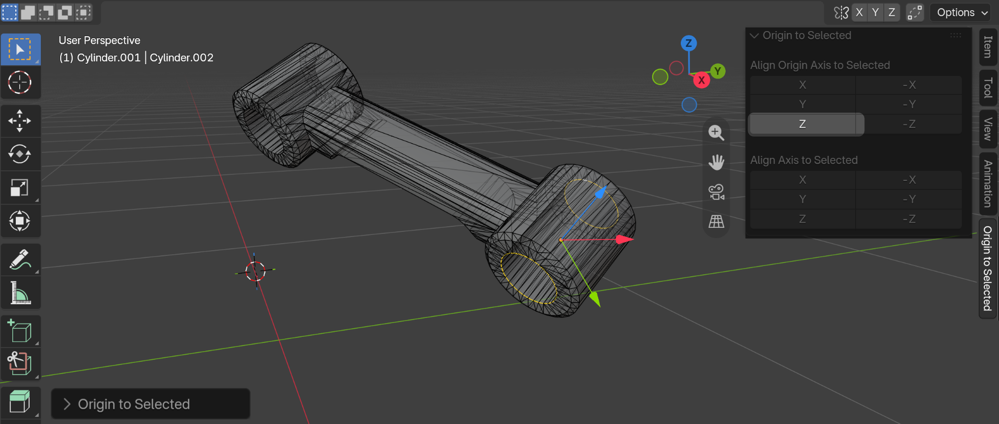

### Special Case: No Identifiable Direction

If the selection has no identifiable direction — for example, a single point, coincident points or a symmetric selection — the chosen local axis is aligned with the **global Z axis**.

The origin is still moved to the selection center.

**Single-point example:** clicking **Y** moves the origin to the selected point and aligns the local Y axis with the global Z axis.

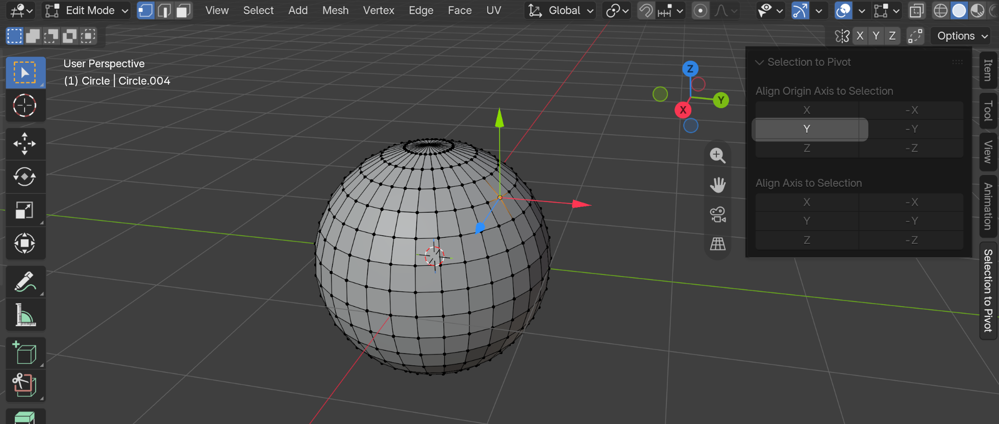

## Align an Axis Without Moving the Origin

This function is available in the **Align Axis to Selected** section of the panel.

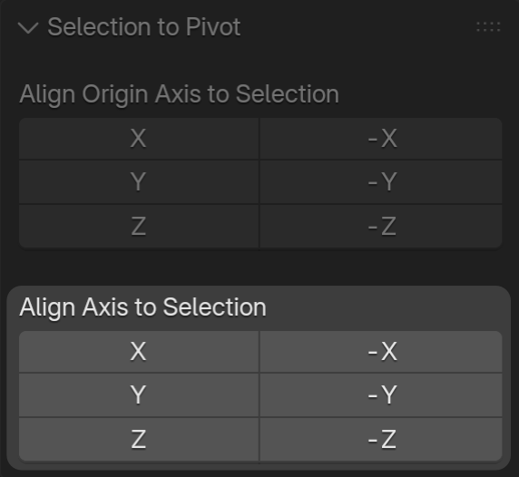

This function aligns the chosen local axis with the direction determined from the selected geometry while keeping the origin in its current position.

### Example

Clicking **X** aligns the local X axis with the selected edge without moving the origin.

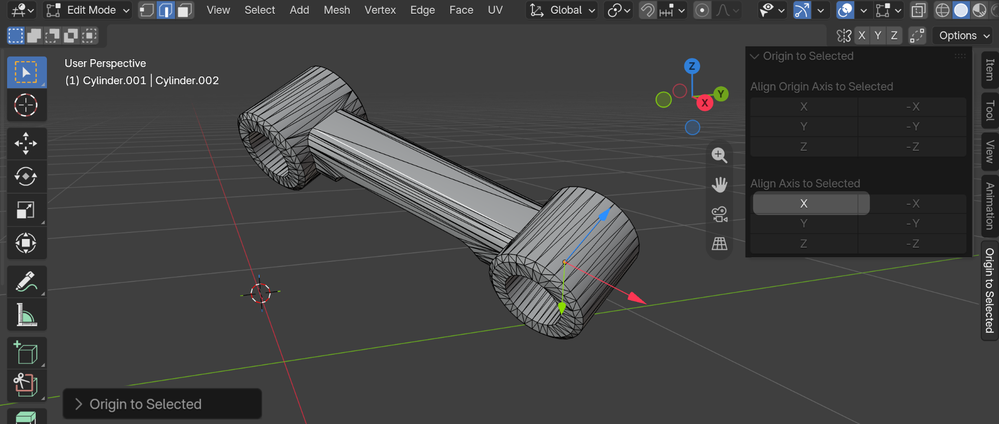

### Special Case: No Identifiable Direction

If the selection has no identifiable direction, the direction from the current origin to the selection center is used instead.

**Single-point example:** clicking **Y** points the local Y axis from the origin toward the selected point without moving the origin.

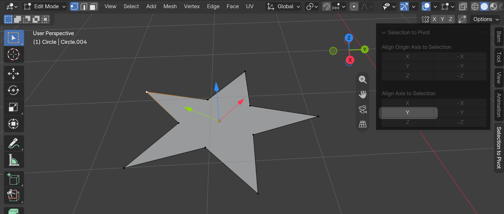

If the selection center coincides with the origin and no direction can be determined, **the operation makes no changes**.

## How the Direction Is Determined

Both functions use the same rules to determine the selection’s direction:

- **Two distinct points:** the direction follows the line connecting the points.
- **Planar selection in Face Select mode:** the direction follows the area-weighted average face normal. If the normals cancel each other out, a normal to the plane is used.
- **Other multi-point selections:** the direction follows the principal direction of the point distribution, provided it is sufficiently distinct.

If these rules cannot determine a direction, the special case described for each function applies.

## Hierarchies, Shape Keys, Bone and Vertex Parenting

The extension also supports the following setups:

- **Object hierarchies:** the mesh object can be part of a parent–child hierarchy. Parenting relationships are preserved, and child object transforms are compensated to keep them in place. Linked copies follow the selection rules described below.
- **Shape keys:** the mesh correction is applied to all shape keys, including **Basis**, so their geometry remains consistent with the new origin and local axes.
- **Bone parenting:** mesh objects parented to armature bones are supported, including posed bones and relative bone parenting. The bone attachment is preserved.
- **Vertex parenting (1 or 3 vertices):** mesh objects attached to a single vertex (**Vertex**) or three vertices (**Vertex (Triangle)**) are supported. Changing the child's origin or local axes preserves its parent, attachment vertices and geometry placement. The object continues to follow the parent when its vertices move.
- **Vertex-parented children:** when changing the parent mesh's origin or local axes, attached child objects are compensated to keep them in place without removing their vertex parenting.

> **Limitations:** modifiers, constraints or animation that depend on the origin or local axes may produce different results after the operation.

## Objects Sharing Linked Geometry

Multiple objects can share the same mesh data, for example after creating linked duplicates with **Alt+D**. Changes to that geometry affect every linked copy.

To change the origin or local axis orientation, the extension modifies the mesh coordinates and recalculates the object’s transform to compensate. This compensation preserves the geometry’s apparent position and orientation.

For objects sharing the active object’s mesh, the behavior depends on whether they are selected:

- **Unselected objects:** their transforms are not recalculated. They receive the shared mesh changes without compensation, so their geometry may visibly move or rotate.
- **Selected objects:** their transforms are also recalculated to compensate for the shared mesh changes.

The geometry remains linked after the operation: the extension does not create a separate mesh for each object.

> **Important:** this refers to **object selection**, not just selected vertices, edges or faces. To compensate for linked copies as well, make sure they are selected before running the operation.

### Example

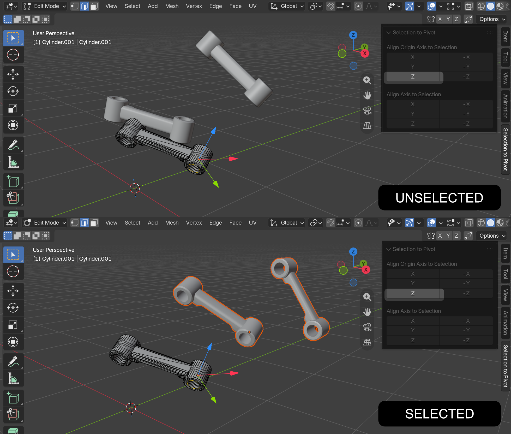

### Limitation: Non-uniform Scale

Object scale values are preserved. If an object has non-uniform scale, compensation does not guarantee that its appearance will remain unchanged when realigning the axes. The extension displays the **Non-uniform scale** warning in this case.

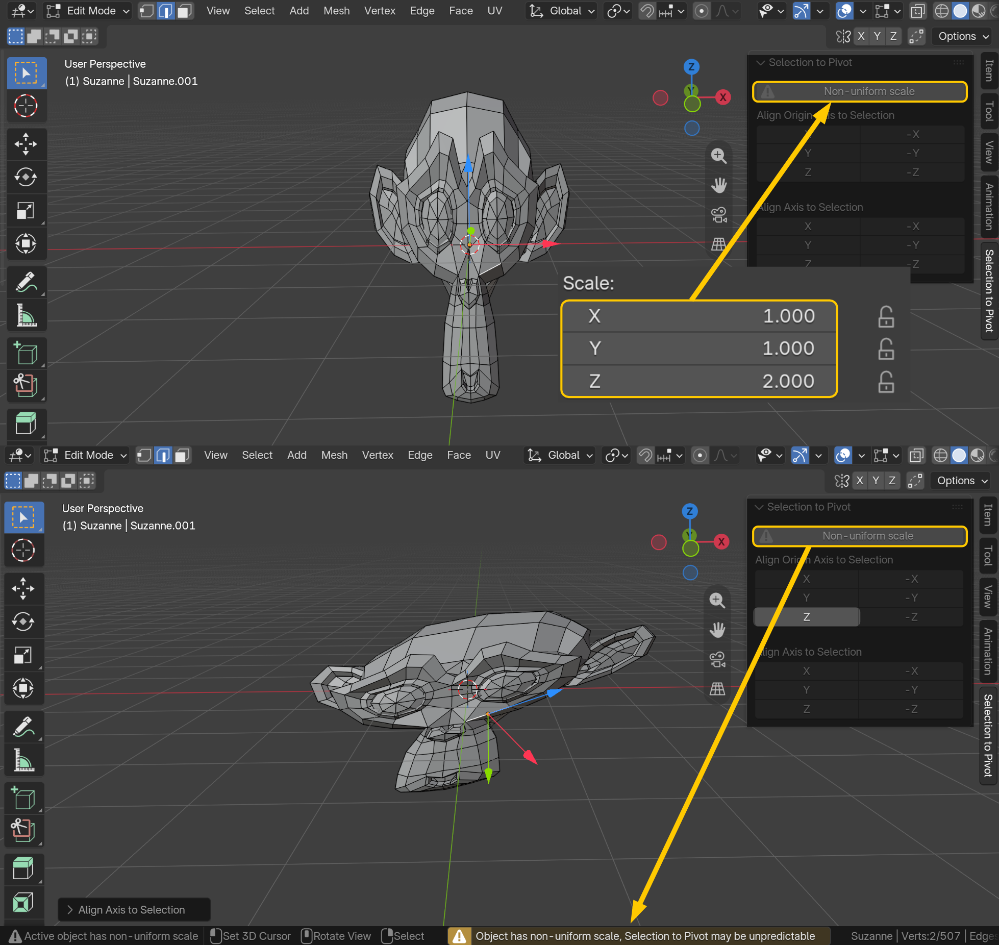

## Note on Axis Visualization

For this documentation, I used a **Geometry Nodes** setup to make the object's local axes easier to see. This setup is only a visual aid and is not required to use the extension.

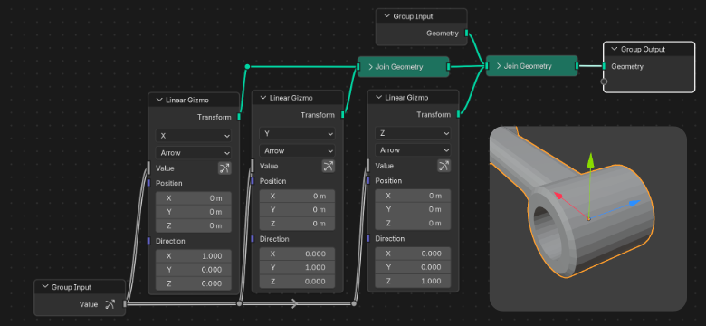

For normal use, I recommend enabling **Axes** under **Object Properties → Viewport Display → Show** to display the object's local axes directly in the viewport.

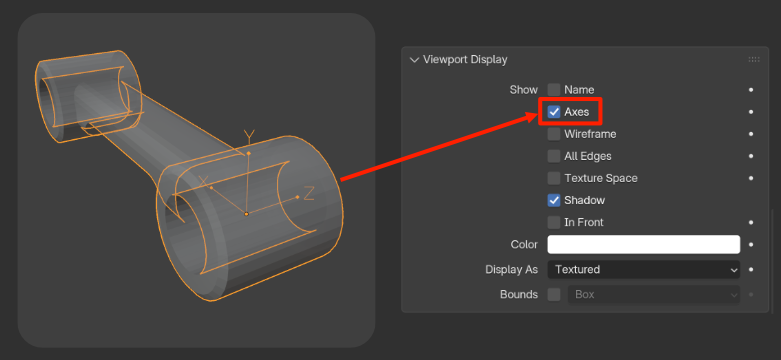
